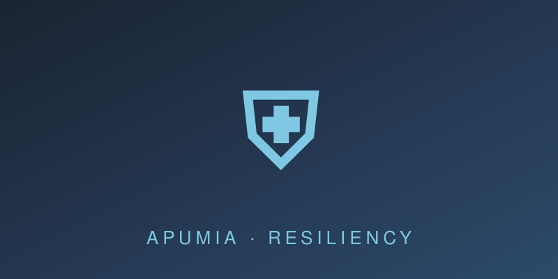

# Apumia Resiliency

**Append-only audit shield для PostgreSQL. 14/14 инвариантов, failover с fencing.**

---

## За 30 секунд

**Что это:** 9 слоёв защиты: append-only аудит, failover с fencing, PII key versioning (без UPDATE), rate limiting (Redis token bucket), circuit breaker, Prometheus/Grafana, Celery worker, SDK.

**Кому:** CTO / Head of Infrastructure в банке на PostgreSQL.

**Почему сейчас:** pgAudit не даёт fencing и PII key versioning. Resiliency — интегрированный стек, который проходит аудит регулятора без сборки из кусков.

**Что доказано:** 14/14 инвариантов PASS (exited with code 0). Load test: 10 567 RPS rate limiter, 500 audit writes через gateway.

**Чего не доказано (честно):** 0 клиентов. ФСТЭК — не в коробке. SDK async — в roadmap.

---

## Оффер

1 200 000 ₽ (код + документы + SDK + Grafana + PII versioning). Пилот с банком топ-50 — 3–7 млн ₽.

**Следующий шаг:** Покажу runbook + 14 инвариантов вживую — 20 минут.

---

## GitHub

- **Private code:** apumiaaifund/apumia-resiliency
- **Public demo:** apumiaaifund/apumia-resiliency-demo

## License

MIT

---

### 🚀 Что мы можем реализовать для партнёров на основе этого решения (Ниши и сценарии)

- **Высоконагруженные сервисы и облака:** автоматическое восстановление при деградации БД/сети и защита от каскадных таймаутов.
- **Критическая ИТ-инфраструктура:** регулярные контролируемые хаос-учения на тестовых контурах.

> **Формат сотрудничества:** запуск пилотного стенда (PoC) за 2–4 недели, лицензирование модуля (On-Premise) или кастомная интеграция под стек заказчика.  
> 📬 **Запросить демонстрацию и расчёт пилота:** [apumiaaifund@gmail.com](mailto:apumiaaifund@gmail.com)

---

### 🛡️ Верификация качества и безопасности (Apumia DevSecOps Gate)

> **Статус:** `VERIFIED & PROVEN` • **Дата аудита:** `16.11.2026`  
> **Контроль архитектуры (`Apumia Blueprint`):** `CLEAN` (`0` циклических зависимостей, контроль сложности McCabe)  
> **Анализ безопасности (`Bandit / Zero-Trust`):** `0` критических уязвимостей  
> **Протокол достоверности (`Apumia Hub`):** `_synthetic: false` | `preservation: 100.0%` | `verified: true`
